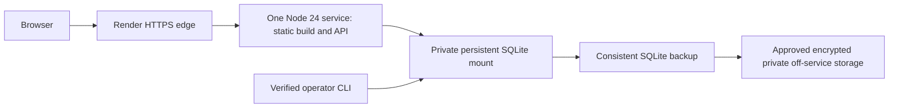

# Beta hosting decision and migration plan

Decision session: October 26, 2026 (America/Chicago). **Recommendation: one paid Render Node/Docker web service with one private persistent SQLite disk, serving the existing static build and API at the same HTTPS origin.** Start closed, then separately approve signup-only and invited-beta stages. Nothing was provisioned, purchased, registered, publicly deployed or connected to an email/payment account.

This is a small-beta design with a prepared/tested application boundary, not production/security approval. Keep `main`, GitHub Pages settings and the existing live V3 app unchanged. College/trades expansion and subscriptions remain deferred.

## Two suitable approaches

Both retain the current Node 24 backend and static frontend without a framework rewrite. A plain static site, Render Free with local SQLite, or an ephemeral serverless filesystem cannot provide durable signup/account/progress storage.

| Concern | Render web service + persistent disk — recommended | Railway service + volume — viable alternative |
|---|---|---|
| Cost evidence | Current pricing page lists a $7/month 512 MB compute tier and $0.25/GB/month disk. **Compute + 1 GB disk floor: about $7.25/month**, before workspace charges, bandwidth, tax, backup storage and optional mail. Confirm exact current paid compute SKU/quote before approval. | Pricing lists Hobby **$5 minimum monthly usage**, including $5 usage credits; actual compute/storage/backup/network usage can exceed it. Volume is usage-billed; no fixed all-inclusive quote was verified. Establish a budget and current quote before selection. |
| TLS/security | Managed certificates and HTTP-to-HTTPS redirect documented; disk and automatic snapshots encrypted at rest. App supplies fixed-origin checks, Secure/HttpOnly cookies, no CORS, stage gates and persistent bounded throttles. Independent app/security and actual edge-header verification still required. | Automatic certificates documented. Same app safeguards are portable. Volume encryption/access/data-region details were not established by the retrieved volume page and require verification; do not assume equivalence. |
| Authentication | Existing opaque single-use email invitation / seven-day session model; no passwords. First small cohort can use privately verified manual email delivery and operator recovery, after security/operations approval. Managed identity remains an alternative if the review requires it. | Same invitation model or a later approved managed identity integration. Hosting does not itself verify student email or implement application recovery. |
| Persistence | Paid persistent mount, single Node instance, SQLite; no horizontal scaling. The free service explicitly loses local files on redeploy/restart/spindown and cannot attach a disk. | Volume attached to one service. Documentation prohibits replicas with volumes and notes redeploy downtime. It does not remove the need for a durable approved plan. |
| Backups | Provider daily encrypted disk snapshots are secondary. Render explicitly warns against disk-snapshot recovery for a custom database. Use application-consistent SQLite VACUUM INTO, encrypted private off-service copies, retention and actual restore drills. | Manual/scheduled volume backups documented (daily 6 days, weekly 27 days, monthly 89 days). Application-consistent SQLite backups and a separate recovery/deletion policy remain necessary; do not assume a volume snapshot is a validated SQLite recovery. |
| Email verification | Hosting supplies no student email verification. Manual delivery only to the opted-in address can establish possession when the link is redeemed; validate delivery/recovery privately. No mail is sent by the app. Optional Resend later needs an approved sender/domain and configuration. | Same; an email provider is separate. No automatic marketing is authorized by signup consent. |
| Maintenance | One process/database to patch, monitor, back up and restore; accept a maintenance window for volume-backed releases. Require operator coverage, quota monitoring and migration/rollback rehearsal. | Similar maintenance, plus usage/budget monitoring. Volume/replica constraints require the same single-writer discipline. |
| Deployment ease | Prepared Dockerfile and deliberately incomplete review-only Render example; auto-deploy off, release stage closed, fixed origin and mounted DB. Closest match to the existing app. | Same Docker image/entry works in principle with provider PORT, HTTPS proxy, persistent path and deployment configuration. No Railway deployment config or live proof was produced. |

These are planning figures, not a purchase quote, guarantee of permanent free service, or account eligibility. The recommended compute SKU must be selected/reconfirmed explicitly: the example does not default a billable plan. Off-service backup and email/operator costs are not included in $7.25. No customer-revenue or willingness-to-pay claim is made.

A Cloudflare alternative was considered but the official Workers pricing, Node compatibility and D1 recovery pages returned 403 in this environment. It would require changing the current HTTP/native-SQLite boundary rather than lifting this image unchanged. It is not one of the two validated recommendations; no free-tier or compatibility claim is based on inaccessible pages.

## Why this is the shortest initial path

Serve the already-built frontend and API together; avoid CORS, duplicated deployments and moving a student token into browser storage. Retain the tested SQLite query/transaction model for a deliberately small cohort, with one instance and measured limits. Migrate to a managed relational database/identity system if security findings, concurrency, recovery objectives or scale require it; that migration is not falsely represented as complete.



Only local fictional-data equivalents have been exercised. The public edge, real disk durability, provider logs, region, off-service backup destination, sender delivery and operator identity have not been provisioned or validated.

## Prepared implementation and fail-closed controls

- `server/main.js` / `npm run dev:beta` still binds loopback and refuses default production startup. Never tunnel/expose it to collect real data.
- `server/hosted.js` is the separate hosted entry. It requires an explicit HTTPS origin, absolute DB path inside the declared persistent mount, non-symlink mount and existing validated build. The default `BEACON_RELEASE_STAGE=closed` accepts only health/config and public static reads, with no signup/account mutation.
- `signup` permits consented beta requests but denies invitation redemption/account work. `invited-beta` permits the free trial and existing account/study tools. Stage configuration is a technical control, **not proof of owner authorization**.
- All hosted payment configuration, Checkout and webhook processing are disabled. Even test credentials are rejected by the hosted settings; provider tests remain on the local development entry until separately authorized. There is no hosted live-payment release stage.
- The configured public Host and mutating-request Origin must match. The trusted edge must provide exactly `X-Forwarded-Proto: https`; alternate forwarded host/IP headers do not authorize requests. Verify provider overwriting/ingress behavior in the approved closed deployment before opening collection. Reject mismatches rather than weakening checks.
- Cookies are Secure/HttpOnly/SameSite=Strict. HSTS, no-store, no-referrer, nosniff, frame denial and CSP are applied. CSP currently retains inline script/style allowances for the preserved V3 app; it is not a strict-CSP or completed security-audit claim. Review that compatibility exception before invitation/payment acceptance.
- Hosted throttles persist global action/account/normalized-email-digest buckets, not raw IP addresses, in SQLite; expiry cleanup and bounded cardinality prevent unbounded bucket growth. Connection-IP throttling remains memory-only in local development. Global beta quotas can be exhausted and require monitoring; no claim of comprehensive bot/DDoS protection is made.
- The hosted process prunes expired sessions/invitations and old uninvited requests/feedback hourly and at startup. Configure approved account/export/backup retention separately; the process does not delete or encrypt off-service exports automatically.

## Implementation files and offline validation

`deployment/Dockerfile` builds with Node 24.19.0, validates content/records and Node tests, then copies only static/server runtime files. It runs as the non-root node user. Source files are root-owned/readable, with a private writable storage directory. The tested container uses a read-only root filesystem and a network-isolated, private test mount; no port is published. The image tag should be replaced by a verified immutable digest for a reviewed deployment. No container vulnerability scan is claimed.

`deployment/render.example.yaml` is **review material, not an applied blueprint**. Confirm the paid compute SKU, limits, region, disk permissions, external origin and costs first. It disables auto-deploy and starts closed. Importing/creating a service later can incur charges and expose a hostname; that requires explicit owner approval.

For a local Docker build in this cloud's managed TLS-proxy environment, use a writable Buildx cache and the existing public CA bundle as a transient BuildKit mount. Do not copy any credential or CA into the image, and do not disable TLS/package integrity verification:

```bash
BUILDX_CONFIG=/tmp/beacon-buildx docker build --secret id=build_ca,src="$NODE_EXTRA_CA_CERTS" -f deployment/Dockerfile -t aptitude-beacon-beta:sprint2 .
docker run --rm -i --network none --read-only --tmpfs /var/data:rw,mode=0700,uid=1000,gid=1000 --tmpfs /tmp:rw,noexec,nosuid,size=32m aptitude-beacon-beta:sprint2 node --input-type=module < tests/container-smoke.mjs
```

On an ordinary trusted network the optional public-CA mount can be omitted. It is not a Stripe/email secret and is absent from the runtime image. Initial build attempts caught a read-only default Buildx cache, the managed proxy certificate chain, and non-root source readability; supported cache/trust/file-mode corrections retained verification and non-root operation.

The container smoke uses fictional data and simulated proxy headers to exercise all three stages, static/private path handling, Secure cookies, guided scoring, process-restart persistence and a consistent backup. It does **not** prove Render deployment, actual TLS, persistence across provider replacements, real-device behavior or off-service disaster recovery.

## Production migration requirements

1. Approve the operator/support/privacy/withdrawal identity, adult eligibility, region/DPA, actual paid hosting budget and backup retention. No DNS/domain purchase is necessary to test a provider hostname; do not assume an email sending domain exists.
2. Independently review authentication, recovery, stage gates, CSRF, proxy trust, CSP exceptions, operator filesystem access, logs, throttles and data handling. Verify manual invitation delivery and requester identity; optionally approve a managed identity/email provider if required. No actual verification delivery has occurred here.
3. Provision only after approval, initially **closed**. Mount `/var/data` with node-user write access and restricted permissions; never silently fall back to `/tmp` or unmounted image storage. Configure one exact HTTPS origin and one instance; confirm actual TLS redirects, headers, health probes and private-path rejection.
4. Use a fresh private beta database, not copied test accounts or fictional paid entitlements. The additive schema preserves old account/progress rows if a separately approved real DB migration is ever needed; do not overwrite an existing database. Take/verify a consistent backup before migration, record counts and identities, stop writes, rehearse restore, then restart the reviewed artifact. Do not roll back to code that cannot serve newly collected study data without a deliberate migration plan.
5. Establish encrypted off-service consistent backups and restore/deletion ownership before inviting students. `npm run owner -- backup /private/new.sqlite` creates a consistent new 0600 file; `node server/verify-backup.js /private/new.sqlite` checks it read-only. A provider disk snapshot alone does not satisfy this gate. Protect exported copies and include them in deletion/incident procedures.
6. New hosting origins cannot read existing GitHub Pages browser storage. Preserve the old site and ask students to export V3/platform backups and deliberately import/merge on the new origin. Nothing is reset or transferred automatically. Guided-study archives are separate activity exports, not V3-compatible imports. Test the migration with representative histories without uploading real records during development.
7. After signup acceptance, separately approve `signup`; after invitation/security/device/recovery acceptance, separately approve `invited-beta`. Do not activate paid sales by changing a stage string. Provider sandbox acceptance, all qualified content/guidance signoff, consumer/merchant terms, image/security checks and a separate reviewed paid implementation/release remain required.

## First-party source evidence

`HOSTING_SOURCE_RECORDS.json` stores successful response hashes/snippets and unavailable destinations for this session. Render pricing/disks/TLS/free/blueprint pages and Railway pricing/volumes/backups/networking were retrieved and scoped-read. Render's snapshot warning is especially relevant to SQLite recovery. Some navigation or dynamic pricing fields were absent from extracted text; no unsupported SKU, data-region or encryption claim is inferred.

Resend's published quota page states 100 transactional emails/day and 3,000/month on its free account, including sent/received emails. That is an optional later-provider fact, not proof of eligibility, verified sender ownership, delivery reliability or a configured account. Current beta delivery remains manual; no automatic marketing is authorized or implemented. Recheck quotas/terms and an owned sender before enabling any sender.
